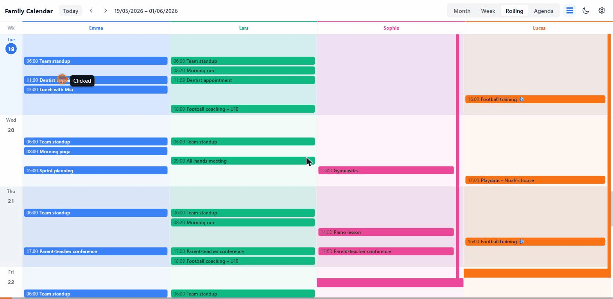
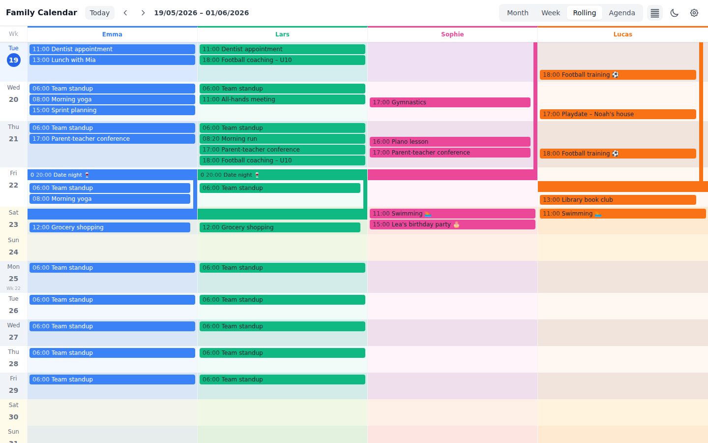
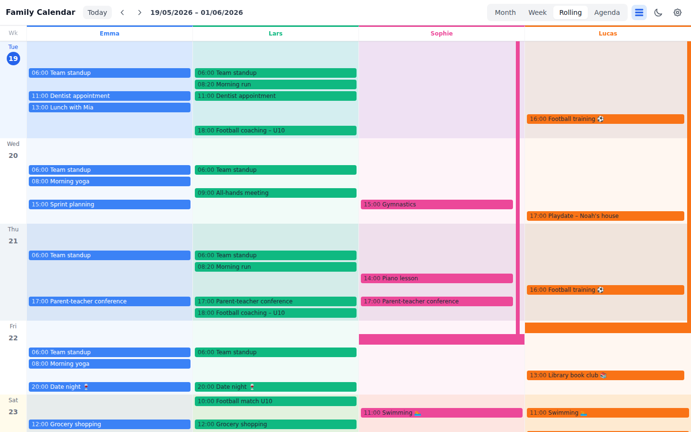
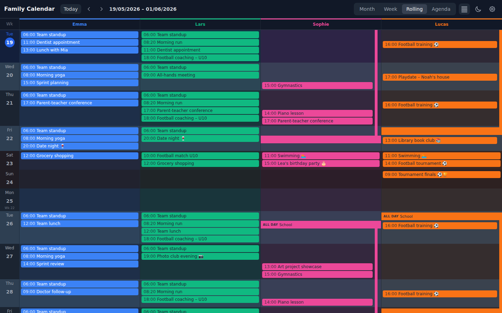
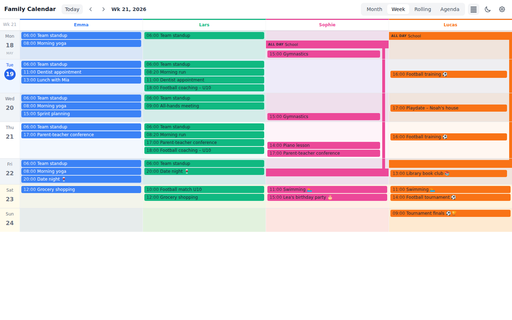
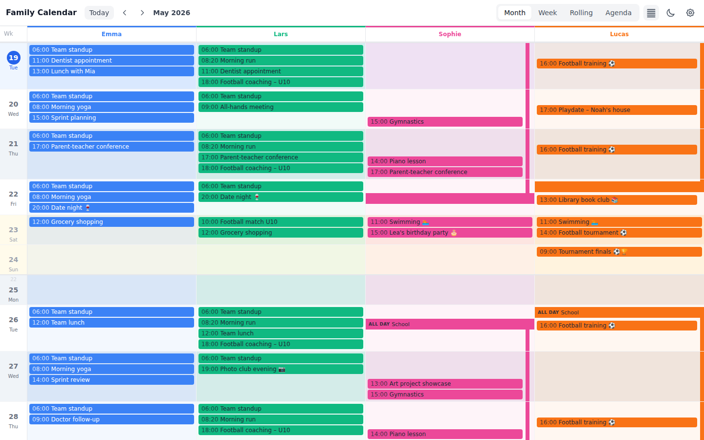
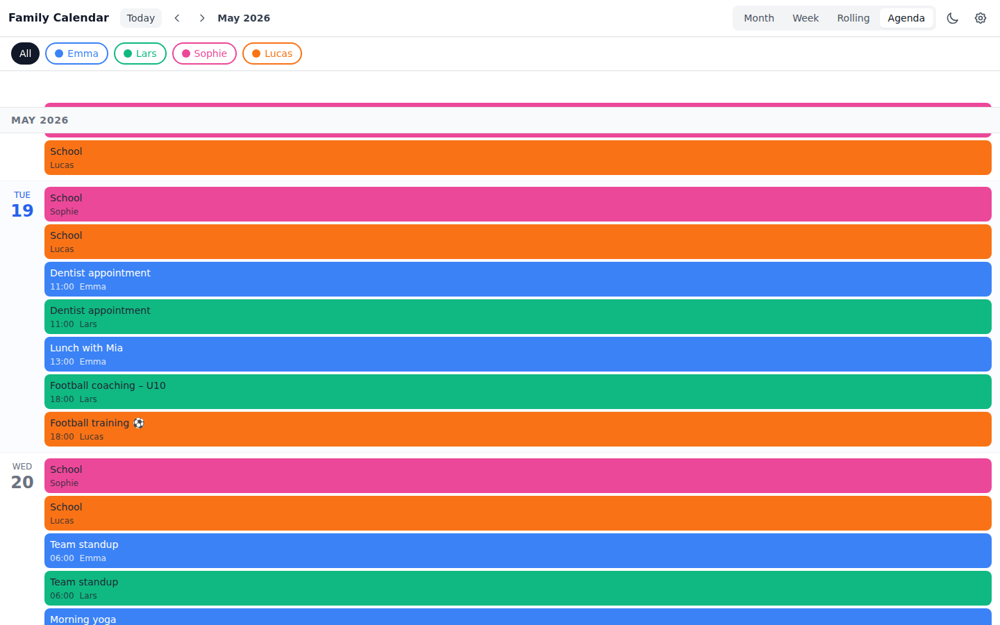
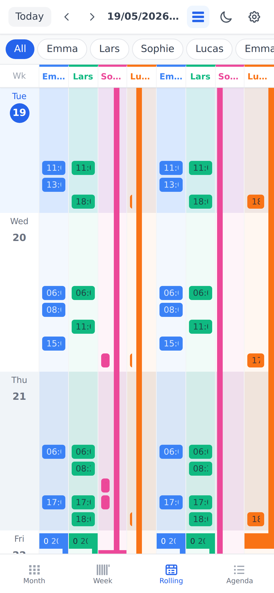

# Family Calendar

<p align="center">
  
</p>

A self-hosted family wall calendar that aggregates multiple iCal feeds into a single shared view. Each family member gets a color-coded column, events are rendered with smart vertical alignment across columns, and multi-day events appear as continuous ribbons.

## Repository Notes

- This repository is safe to publish: runtime data is excluded via `.gitignore` (`data/`, `.env*`, build output).
- API documentation is maintained in `docs/API.md`.
- Optional deployment helpers are documented in `contrib/README.md`.
- Contribution guide: `CONTRIBUTING.md`.
- Security policy: `SECURITY.md`.
- Release summary: `RELEASE_NOTES.md`.
- Maintainer checklist: `docs/MAINTAINER_CHECKLIST.md`.

## Features

- **Multiple views** — Month, Week, Rolling (configurable day range), and Agenda
- **Compact / aligned toggle** — switch between a compact stacked layout and a slot-aligned layout where same-day events appear at the same vertical position across all person columns; available in Month, Week, and Rolling views
- **Per-person color coding** — each family member has a unique color applied to their events and column background
- **Multi-day event ribbons** — spans render as continuous colored strips across days
- **iCal support** — subscribe to URLs (Google Calendar, iCloud, etc.) or upload `.ics` files
- **Event overrides** — restrict specific events to only show under certain people
- **Auto-refresh** — configurable background sync interval (default 60 minutes)
- **Dark mode** — system-aware dark/light theme
- **PWA** — installable on mobile and desktop
- **Localization** — English and Norwegian, including Norwegian public holidays (2025–2027)
- **Timezone support** — configurable display timezone (default: Europe/Oslo)

## Screenshots

### Demo

Quick tour of the Family Calendar UI, including view switching and event layout behavior.

### Rolling view — compact layout (toggle off)


### Rolling view — aligned layout (toggle on)


### Rolling view — dark mode


### Week view


### Month view


### Agenda view


### Mobile


## Quick Start

### With Docker Compose (recommended)

```bash
git clone https://github.com/randriksen/family-calendar.git
cd family-calendar
docker-compose up -d
```

Then open **http://localhost:3000** in your browser.

The `./data` directory is created automatically on first run and contains the SQLite database and uploaded files. Nothing is stored inside the container.

### First-time setup

1. Go to **http://localhost:3000/settings**
2. Under **People** — add each family member and assign them a color
3. Under **Calendars** — add iCal sources (URL or `.ics` file upload) and assign them to people
4. Return to the main page to see the calendar

## Docker

### Production

```bash
docker-compose up -d
```

| Resource | Value |
|---|---|
| Port | `3000` |
| Data volume | `./data:/data` |
| Database | `./data/calendar.db` |
| Uploads | `./data/uploads/` |

### Development (live reload)

```bash
docker-compose -f docker-compose.dev.yml up
```

Source code is mounted into the container and the Next.js dev server reloads on changes.

### Building manually

```bash
docker build -t family-calendar .
docker run -d \
  --name family-calendar \
  -p 3000:3000 \
  -v /path/to/data:/data \
  family-calendar
```

## Proxmox LXC

Docker has compatibility issues with some Proxmox VE kernels (AppArmor/runc). Running inside an LXC container with Node.js directly avoids this entirely.

### 1. Create the LXC container

In the Proxmox web UI, create a new LXC container using the **Debian 12** template. Recommended specs: 1 CPU, 512 MB RAM, 4 GB disk. Enable **nesting** if you want to run Docker inside the LXC later, but it's not required here.

Start the container and open a shell.

### 2. Install Node.js 20

```bash
apt-get update && apt-get install -y curl git build-essential python3
curl -fsSL https://deb.nodesource.com/setup_20.x | bash -
apt-get install -y nodejs
```

### 3. Install the app

```bash
useradd -r -m -d /opt/family-calendar -s /bin/bash family-calendar
git clone https://github.com/randriksen/family-calendar.git /opt/family-calendar
cd /opt/family-calendar
npm install
npm run build
mkdir -p /opt/family-calendar/data/uploads
chown -R family-calendar:family-calendar /opt/family-calendar/data
```

### 4. Install the systemd service

```bash
cp /opt/family-calendar/contrib/family-calendar.service /etc/systemd/system/
systemctl daemon-reload
systemctl enable --now family-calendar
```

The app will be available at **http://\<LXC-IP\>:3000** and will start automatically on boot.

### Updating

```bash
cd /opt/family-calendar
git pull
npm install
npm run build
systemctl restart family-calendar
```

## Environment Variables

| Variable | Default | Description |
|---|---|---|
| `DATABASE_PATH` | `/data/calendar.db` | SQLite database file path |
| `UPLOADS_PATH` | `/data/uploads` | Directory for photos and uploaded `.ics` files |
| `NODE_ENV` | `production` | Node environment |
| `PORT` | `3000` | HTTP port |
| `HOSTNAME` | `0.0.0.0` | Bind address |

## Settings

All settings are configurable from the **Settings → Display** tab:

| Setting | Default | Description |
|---|---|---|
| `locale` | `en` | UI language (`en` or `no`) |
| `app_name` | `Family Calendar` | Name shown in the browser title |
| `default_view` | `rolling` | Starting view: `month`, `week`, `rolling`, or `agenda` |
| `refresh_interval_minutes` | `60` | How often to sync iCal sources |
| `rolling_days` | `31` | Number of days shown in Rolling view |
| `display_timezone` | `Europe/Oslo` | Timezone for rendering events |
| `date_format` | `dd/MM/yyyy` | Date format string |

## Lite Mode

`/lite` is a deliberately plain version of the calendar for old or weak devices — an Android 4.4 tablet on the wall, for example. It shows one month, week, day or seven-day schedule (timeplan) at a time and sends **no client-side JavaScript at all**: every page is static HTML, navigation is ordinary links, and the page reloads itself with `<meta http-equiv="refresh">` to pick up new events. The stylesheet avoids CSS Grid, custom properties and `position: sticky`, so it renders on a stock KitKat WebView as well as on modern browsers.

```
http://<host>:3000/lite
http://<host>:3000/lite?view=week&date=2026-10-29
http://<host>:3000/lite?view=day&person=<person-id>&refresh=120
```

| Parameter | Values | Default |
|---|---|---|
| `view` | `month`, `week`, `day`, `schedule` | the app's default view |
| `date` | `YYYY-MM-DD` | today in the display timezone |
| `person` | a person id | all people |
| `refresh` | seconds between reloads (30–3600), `0` to disable | `300` |

Month cells show up to four events and link to the day view for the rest, which keeps the DOM small on slow hardware.

### Running it on a Philips signage tablet

On a Philips/TPV Android signage display (tested on a 10BDL3051T, Android 4.4, 1 GB RAM) use the built-in **Browser** source rather than Firefox or Chrome. It launches Chromium's bare content shell, which showed `/lite` at ~45–60 MB total versus ~100 MB for an idle Firefox, and it is the only option the display can start by itself after a power cut:

1. Browser source → **Settings** → put `http://<host>:3000/lite` in URL slot 1 → OK.
2. Admin menu → Settings → Signage Display → Source settings → **Boot on source** → Input: Browser, Playlist: 1.

## Technology Stack

| Layer | Technology |
|---|---|
| Framework | Next.js 14 (App Router, standalone output) |
| Language | TypeScript 5 |
| Styling | Tailwind CSS 3 |
| Database | SQLite via `better-sqlite3` |
| Calendar parsing | `node-ical` |
| Date utilities | `date-fns` |
| Runtime | Node.js 20 (Alpine Linux) |

## Architecture

```
src/
├── app/
│   ├── page.tsx              # Main calendar page
│   ├── settings/page.tsx     # Admin settings UI
│   └── api/
│       ├── people/           # People CRUD + photo upload
│       ├── sources/          # Calendar source CRUD + refresh + overrides
│       ├── events/           # Event queries + force refresh
│       ├── settings/         # App settings
│       └── upload/           # iCal file upload
├── components/
│   ├── calendar/
│   │   ├── CalendarView.tsx  # Top-level view switcher
│   │   ├── MonthView.tsx
│   │   ├── WeekView.tsx
│   │   ├── RollingView.tsx
│   │   ├── AgendaView.tsx
│   │   ├── DayCell.tsx       # Per-day cell with ribbons and event badges
│   │   └── calendarUtils.ts  # Layout algorithms (lanes, slot alignment)
│   └── settings/
│       ├── PeopleSettings.tsx
│       ├── CalendarSettings.tsx
│       └── DisplaySettings.tsx
└── lib/
    ├── db.ts                 # SQLite schema, migrations, all CRUD
    ├── ical.ts               # iCal fetch, parse, normalize
    ├── scheduler.ts          # Background auto-refresh
    ├── colorUtils.ts         # Color helpers (hexWithAlpha)
    └── i18n.ts               # Localization
instrumentation.ts            # Next.js startup hook — initializes DB & scheduler
```

## Database Schema

The SQLite database is created and migrated automatically on startup. No manual setup is required.

| Table | Description |
|---|---|
| `people` | Family members (name, color, display order, photo) |
| `calendar_sources` | iCal feed definitions (URL or file path, assigned people) |
| `source_people` | Many-to-many junction between sources and people |
| `events` | Parsed calendar events (title, dates, all-day flag, etc.) |
| `event_person_overrides` | Restricts specific events to selected people |
| `settings` | Key-value application configuration |

## API Reference

Full API docs are available in `docs/API.md`.

### Quick Endpoint Index

| Method | Endpoint |
|---|---|
| `GET` | `/api/people` |
| `POST` | `/api/people` |
| `GET` | `/api/people/:id` |
| `PUT` | `/api/people/:id` |
| `DELETE` | `/api/people/:id` |
| `POST` | `/api/people/:id/photo` |
| `GET` | `/api/sources` |
| `POST` | `/api/sources` |
| `GET` | `/api/sources/:id` |
| `PUT` | `/api/sources/:id` |
| `DELETE` | `/api/sources/:id` |
| `POST` | `/api/sources/:id/refresh` |
| `GET` | `/api/sources/:id/events` |
| `GET` | `/api/sources/:id/overrides` |
| `PUT` | `/api/sources/:id/overrides` |
| `POST` | `/api/sources/:id/check-event` |
| `GET` | `/api/events` |
| `POST` | `/api/events/refresh` |
| `GET` | `/api/settings` |
| `PUT` | `/api/settings` |
| `POST` | `/api/upload` |

## Public Release Checklist

- Confirm no private data exists under `data/` before publishing (this folder is ignored, but check local copies).
- If exposing publicly, protect the app with reverse-proxy auth (the API currently has no auth layer).
- Review branding fields in `unraid-template.xml` and Docker labels if you fork/rename.

## Data Persistence

All persistent data lives under the mapped `/data` volume:

```
data/
├── calendar.db       # SQLite database
└── uploads/
    ├── *.ics         # Uploaded calendar files
    └── *.jpg / *.png # Person photos
```

Back up the `data/` directory to preserve all calendar data, photos, and settings.

## Localization

Set the locale in **Settings → Display**. Currently supported:

- `en` — English
- `no` — Norwegian (includes Norwegian public holidays for 2025–2027)

## License

MIT
